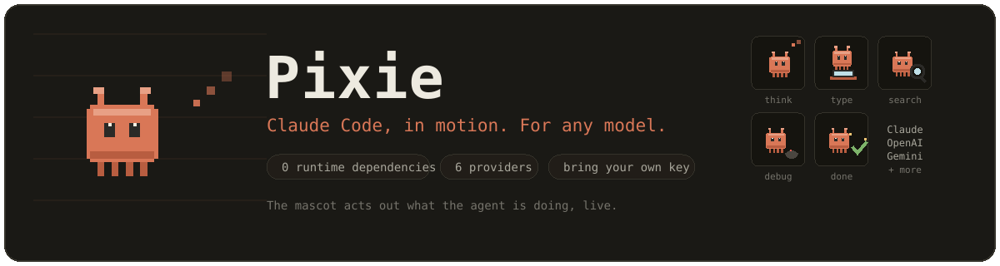

<p align="center">
  
</p>

<p align="center">
  <a href="https://anwardebes.github.io/Claude-Code-In-Motion/"></a>
  <a href="https://github.com/AnwarDebes/Claude-Code-In-Motion/releases"></a>
  
  <a href="LICENSE"></a>
  
  
  
</p>

<p align="center">
A local coding agent you run in your own terminal and watch in your browser.
Bring your own API key for any provider, and a little pixel creature acts out
what the agent is doing while it works: typing, searching, editing, running, and
debugging.
</p>

<p align="center">
  <a href="https://anwardebes.github.io/Claude-Code-In-Motion/"><b>Try the live demo</b></a> ·
  <a href="#quick-start">Quick start</a> ·
  <a href="#safety">Safety</a> ·
  <a href="#how-it-works">How it works</a>
</p>

https://github.com/user-attachments/assets/d4fe63eb-93f0-4408-9867-dc253bb104a8

<sub>The session in the video is the real UI from <code>web/</code> replaying a recorded run, not a mockup. Sound on.</sub>

---

## What it is

Pixie is a small, dependency-free coding agent that runs on your machine. It can
read, search, edit, and run code in whatever folder you start it in. You pick the
model (Claude, GPT, Gemini, anything on OpenRouter, or a local Ollama model) and
paste your own API key. Nothing is sent anywhere except to the provider you chose.

The twist: instead of a spinner, Pixie shows you an animated pixel mascot that
reflects what it is doing in real time, so you can follow along at a glance.

| The agent is... | The mascot... |
| --- | --- |
| thinking | looks up while little thought-dots rise |
| writing a reply | taps away at a tiny laptop |
| reading a file | holds up a document and scans it |
| editing a file | scribbles on paper with a pencil |
| searching the code | sweeps a magnifying glass around |
| running a command | watches a little terminal |
| debugging / testing | chases a bug across the floor |
| waiting for your approval | holds up a speech bubble with a question mark |
| finished | jumps with sparkles and a check |
| something failed | wilts with a sweat drop |

## Quick start

You need Node.js 18.17 or newer. Install Pixie straight from GitHub, then run it
**inside the project folder you want to work on**:

```bash
npm install -g github:AnwarDebes/Claude-Code-In-Motion
cd your-project
pixie
```

Or try it once without installing anything globally:

```bash
npx github:AnwarDebes/Claude-Code-In-Motion
```

Or run it from a checkout:

```bash
git clone https://github.com/AnwarDebes/Claude-Code-In-Motion
node Claude-Code-In-Motion/bin/pixie.js --dir your-project
```

Your browser opens automatically. Click the gear, pick a provider, paste an API
key, and start chatting.

```
  ✻ Pixie is awake.

  Working in  /path/to/your/project
  Open        http://127.0.0.1:4317
  Stop        Ctrl+C
```

Just want to look first? The [live demo](https://anwardebes.github.io/Claude-Code-In-Motion/)
runs the same UI in your browser against a recorded session: no install, no key,
and you decide whether the edit goes through.

## Providers

Pixie talks to providers directly over HTTPS. No SDKs, no proxy.

| Provider | Notes | Key |
| --- | --- | --- |
| **Anthropic (Claude)** | default; adaptive effort and Fable-5 fallbacks built in | `ANTHROPIC_API_KEY` |
| **OpenAI** | GPT models | `OPENAI_API_KEY` |
| **Google Gemini** | Gemini models | `GEMINI_API_KEY` |
| **OpenRouter** | one key, hundreds of models | `OPENROUTER_API_KEY` |
| **Ollama** | fully local, no key needed | run `ollama serve` |
| **Custom** | any OpenAI-compatible endpoint | your base URL + key |

You can set a key in the settings panel, or export the matching environment
variable before launching. Keys are stored only in `~/.pixie/config.json` on your
machine, with `0600` permissions.

## Options

```
pixie [options]

  -p, --port <n>     port to listen on            (default 4317)
      --host <addr>  address to bind              (default 127.0.0.1)
  -d, --dir <path>   working directory            (default current directory)
      --yolo         auto-approve every tool call except catastrophic ones
      --no-open      do not open the browser automatically
  -h, --help         show help
```

## Safety

The agent proposes actions; **your machine decides whether to run them.** This is
enforced by the harness, not by the model, so a confused or adversarial model
cannot get around it.

- Read-only tools (read, list, search) run without asking.
- Writing files, editing files, and shell commands ask for approval first. You
  can allow once, allow for the rest of the session, or deny.
- Read-only shell commands (`ls`, `cat`, `git status`, and friends) run without a
  prompt so it does not nag you.
- Catastrophic commands (deleting the system or home directory, formatting a
  disk, piping the internet into a shell) are refused outright, even in `--yolo`
  mode.
- The agent can only touch files inside the folder you launched it in. Reading
  credential files (`.env`, `.ssh`, and similar) is blocked.

## How it works

```
bin/pixie.js        CLI: parse flags, start server, open browser
src/server.js       zero-dep HTTP + SSE server
src/agent.js        the provider-agnostic agent loop
src/providers/      anthropic, openai-compatible, gemini (raw fetch)
src/tools/          read, write, edit, list, glob, grep, bash
src/safety.js       the deny / ask / allow permission gate
web/                the browser UI and the canvas mascot
demo/               a recorded session and the replay that powers the live demo
test/               node:test suite (safety, providers, agent, mascot, markdown)
```

The browser holds one Server-Sent-Events connection. As the agent works it emits
normalized events (`tool_start`, `message`, `approval_request`, and so on). The
transcript renders them, and a small finite state machine maps them to the
mascot's animation states.

The [live demo](https://anwardebes.github.io/Claude-Code-In-Motion/) uses that
seam: `demo/replay.js` stands in for the server and plays back a recorded event
stream, so the unmodified UI from `web/` renders it exactly as it would a live
session. The tool output in the recording (the file contents, the search hits,
the diff and the test run) is what Pixie's tools really returned; the model's
replies were scripted.

## Privacy

Everything runs locally. Your code never leaves your machine except as part of the
prompts you send to the model provider you selected. There is no telemetry and no
account.

## Development

There is no build step. Edit the files and restart `node bin/pixie.js`. The whole
thing is plain ES modules with zero runtime dependencies.

Run the test suite with `npm test` (it uses the built-in `node:test` runner, so
there is nothing to install). It covers the permission gate, the three provider
families against mock servers, the agent loop with approvals, the markdown
renderer, and the mascot state machine.

## License

MIT. See [LICENSE](LICENSE).
